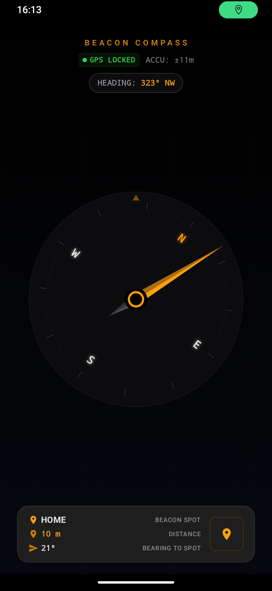

# Beacon Compass

Beacon Compass is an offline, navigation and homing compass application for Android. Designed for outdoor enthusiasts, hikers, travelers, and field operators, the app provides real-time directional homing to saved coordinates and waypoints without requiring an internet connection or cellular signal.

The application leverages hardware sensor fusion—combining raw GPS satellite fixes with accelerometer and geomagnetic field sensors—to calculate live heading, target bearing, range delta, and line-of-sight navigation metrics. Built with Jetpack Compose and modern Android architecture, Beacon Compass features a battery-preserving, high-contrast OLED tactical interface with night-vision-friendly fluorescent amber instrumentation.

  

## Key Features

- Offline Direct Homing: Locks onto saved target coordinates and computes direct heading vectors and bearing deltas in real time.
- Low-Power Sensor Fusion: Seamlessly blends magnetic compass orientation and GPS satellite telemetry while automatically releasing sensors when paused to conserve battery.
- High-Contrast OLED Night Interface: Pure black (#000000) background with aviation-style fluorescent amber elements designed for sunlight readability and dark-adapted vision.
- Precision Navigation Readouts:
  - Live device heading in degrees and cardinal/intercardinal direction.
  - Calculated bearing to the active target waypoint.
  - Relative deviation angle indicating off-course drift.
  - Dynamic distance calculation (meters, kilometers, miles) using geodesic formulas.
  - Current elevation/altitude and precision GPS satellite coordinates.
  - Real-time GPS lock indicator (Locked, Searching, Offline).
- Waypoint Management:
  - Save, edit, and organize multiple destination beacons.
  - Quick-switch active homing targets with a single tap.
  - Capture current GPS position as a new waypoint instantly.
  - Local persistence powered by Room database with zero cloud telemetry.

## Technical Stack & Architecture

- Language: Kotlin
- UI Framework: Jetpack Compose with Material Design 3
- Architecture: Model-View-ViewModel (MVVM) with Unidirectional Data Flow
- Concurrency: Kotlin Coroutines and StateFlow
- Local Database: AndroidX Room
- Hardware Sensors: Android SensorManager (Type Accelerometer & Magnetic Field) and LocationManager (GPS & Network Providers)
- Build System: Gradle Kotlin DSL (AGP 8.x, Java 21 target)

## Permissions

Beacon Compass requires minimal, privacy-focused permissions strictly needed for on-device navigation:

- `android.permission.ACCESS_FINE_LOCATION`: Required to read accurate GPS satellite positioning.
- `android.permission.ACCESS_COARSE_LOCATION`: Fallback network-based location when available.

No network access or internet permissions (`android.permission.INTERNET`) are required or requested. Your location data remains private and never leaves your device.
